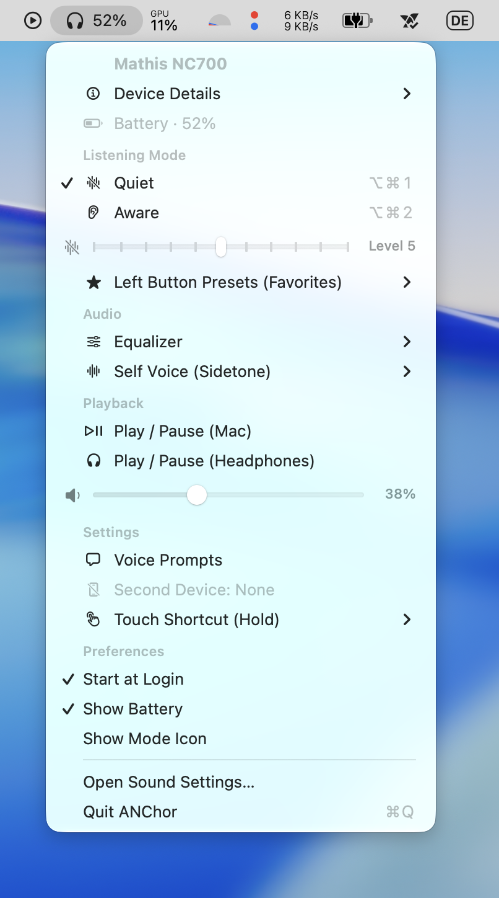

# ANChor ⚓

A lightweight macOS menu bar app for controlling Bose headphones and earbuds (Bose Noise Cancelling Headphones 700, QuietComfort series, and more) noise cancellation modes and audio settings.


## Features

- 🎧 **Menu bar integration** — always accessible, lightweight utility with no dock icon
- 🔋 **Battery levels** — live battery percentage displayed in the menu bar and dropdown
- 🔇 **Noise control** — switch between Quiet and Aware modes (⌥⌘1 / ⌥⌘2) or adjust noise cancellation levels
- 🎚️ **Equalizer & Sidetone** — customize Bass, Mid, Treble, and Self Voice levels
- ⚡ **Instant switching** — direct RFCOMM/BMAP communication, auto-reconnecting on Bluetooth connection
- 🚀 **Start at Login** — native macOS ServiceManagement integration

## Screenshot



The menu bar shows a headphone icon with battery percentage and current mode indicator. Clicking it reveals:

- Connected device name and device details
- Battery percentage (and per-earbud levels where applicable)
- Listening modes (Quiet / Aware) and continuous noise level slider
- Left button favorite presets
- Audio settings (Equalizer, Self Voice / Sidetone)
- Playback controls (secondary device play/pause, headphone volume)
- Settings (Voice Prompts, Touch Shortcut)
- Preferences (Start at Login, Menu Bar display toggles) and Quit

## Supported Devices

| Device | Codename | Product ID | Status |
|--------|----------|-----------|--------|
| Noise Cancelling Headphones 700 | goodyear | 0x4024 | ✅ Tested |
| QC Ultra Earbuds (2nd Gen) | edith | 0x4062 | Should work* |
| QC Ultra Earbuds (1st Gen) | scotty | 0x4072 | Should work* |
| QC Ultra Headphones | wolverine | 0x4060 | Should work* |
| QuietComfort 45 | fuji | 0x403E | Should work* |
| QC Earbuds | lando | 0x402F | Should work* |

*These devices use the same BMAP protocol. Contributions with test results welcome!

## Requirements

- macOS 13+ (Ventura or later)
- Bose earbuds/headphones paired and connected via Bluetooth
- Xcode Command Line Tools (for building)

## Installation

### Download a release (recommended)

1. Grab the latest `ANChor-vX.Y.Z.zip` from the [Releases page](https://github.com/mathismueller/ANChor/releases).
2. Unzip and move `ANChor.app` to `/Applications`.
3. **First launch:** the build is ad-hoc signed (not notarized through the Apple Developer Program), so macOS Gatekeeper will block it the first time:
   - Try to open `ANChor.app` once and dismiss the warning, then go to **System Settings → Privacy & Security** and click **Open Anyway**.
   - Or clear the quarantine attribute from a terminal:

```bash
xattr -d com.apple.quarantine /Applications/ANChor.app
```

After the first launch, it opens normally.

### Build from source

```bash
git clone https://github.com/mathismueller/ANChor.git
cd ANChor
swift build -c release
```

The binary will be at `.build/release/ANChor`.

### Create an app bundle (optional)

```bash
./scripts/bundle.sh
# Creates ANChor.app — drag to /Applications
```

### Run

```bash
# Direct binary
.build/release/ANChor

# Or if you created the app bundle
open ANChor.app
```

### Launch at Login

1. Move `ANChor.app` to `/Applications`
2. Open **System Settings → General → Login Items**
3. Click **+** under "Open at Login"
4. Select `ANChor` from Applications

## Configuration

ANChor **automatically discovers** paired Bose devices — no manual setup required. It scans your paired Bluetooth devices for known Bose name patterns and connects to the first one found (preferring already-connected devices).

If multiple Bose devices are paired, it will connect to whichever is currently active.

## How It Works

ANChor communicates with Bose devices using the **BMAP (Bose Messaging and Protocol)** over Classic Bluetooth RFCOMM channel 2. This is the same protocol the Bose Music app uses.

### Protocol Overview

```
Packet: [fblock_id, function_id, operator, payload_length, ...payload]

Operators:
  0x01 = GET    (read a value)
  0x05 = START  (trigger action, e.g. mode switch)

Key addresses:
  [31.3] = Current noise mode (0=Quiet, 1=Aware)
  [2.2]  = Battery levels
  [1.5]  = CNC level (0-10 slider)
  [0.5]  = Firmware version
```

### Mode Switching

```
TX: [0x1F, 0x03, 0x05, 0x02, mode_idx, announce_flag]
RX: [0x1F, 0x03, 0x06, 0x01, new_mode_idx]  (RESULT = success)
```

## Known Limitations

- **macOS only** — uses IOBluetooth framework (no Linux/Windows support)
- **RFCOMM channel lockout** — if the app crashes or disconnects uncleanly, you may need to disconnect/reconnect your device via System Settings before the app can reconnect
- **Direct CNC slider** — available on models supporting direct CNC commands (such as NC 700); on devices requiring cloud authentication for arbitrary CNC levels, modes switch between presets (Quiet / Aware)

## Troubleshooting

**"Connecting..." stays forever**
- Disconnect device from Bluetooth (System Settings → Bluetooth → Disconnect)
- Reconnect device
- Click "Reconnect" in the menu or restart the app

**No battery shown**
- Close and reopen the menu — the app re-queries device state every time the menu opens. If it still doesn't appear, click "Reconnect".

## Acknowledgments

- **[bosectl](https://github.com/aaronsb/bosectl)** by Aaron Bockelie — BMAP protocol documentation and reference implementation that made this project possible. The protocol knowledge (packet format, feature addresses, device catalog) was invaluable.
- **[Bose-QuietComfort-Ultra-Protocol](https://github.com/docentYT/Bose-QuietComfort-Ultra-Protocol)** by docentYT — additional protocol documentation.

## Contributing

Contributions welcome! Especially:
- Testing with other Bose devices (QC45, QC35, etc.)
- Additional protocol reverse engineering for newer firmware
- SwiftUI popover UI (alternative to NSMenu)

## License

MIT — see [LICENSE](LICENSE).
